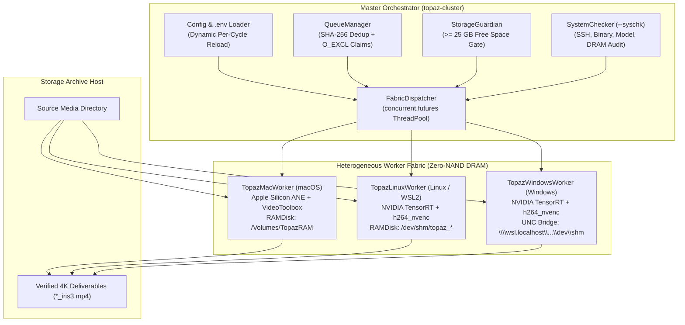

# topaz-video-fabric

**Heterogeneous Zero-NAND DRAM-Staged 4K Video Upscaling Orchestrator for Apple Silicon (ANE + VideoToolbox) & NVIDIA (TensorRT + NVENC) Compute Fabrics**

[](LICENSE)
[](https://www.python.org/)
[](#key-architectural-features)

---

> [!IMPORTANT]
> **Commercial Licensing & Trademark Disclaimer**
>
> `topaz-video-fabric` is an independent, open-source distributed queue, RAMDisk staging, and SSH orchestration framework. It is **not** affiliated with, endorsed by, or sponsored by **Topaz Labs LLC**.
>
> - **No Proprietary Assets Included:** This repository contains **zero** proprietary binaries, **zero** neural network model weights, and **zero** authentication/license tokens.
> - **Bring Your Own License (BYOL):** To use this orchestrator, you must hold a valid, active license for **Topaz Video AI** from [Topaz Labs](https://www.topazlabs.com/) and authenticate your installation on the target worker node(s) in compliance with the Topaz Labs End User License Agreement (EULA), including multi-seat or Pro licensing requirements when operating across multiple machines.

---

## Motivation & Why Use This?

Modern AI video generation—both cloud APIs (such as **Google Gemini / Veo**, **Sora**, **Runway**, **Kling**, and **Luma**) and local open-weight diffusion models (**Wan**, **HunyuanVideo**, **LTX-Video**, **CogVideoX**)—almost universally generates clips at **low-to-medium base resolutions** (`464p`, `480p`, `540p`, `720p`, or `1080p`) across mixed aspect ratios (`16:9` landscape, `9:16` vertical, `1:1` square) to keep generation latency, VRAM footprints, and cloud API token costs practical.

While generating dozens or hundreds of base-resolution clips in the cloud takes only minutes, turning those raw generative outputs (or legacy archival libraries) into crisp, artifact-free **4K UHD (`3840x2160` / `2160x3840`)** masters creates a massive local compute bottleneck:
1. **The "Generate Fast -> Stage -> Upscale All to 4K" Workflow Gap:** Doing manual, one-by-one GUI exports for a folder of 100+ cloud-generated clips is tedious, prone to aspect-ratio cropping mistakes, and wastes time re-rendering duplicate downloads.
2. **SSD Wear & I/O Bottlenecks:** Staging intermediate conditioned files and multi-gigabyte 4K streams on internal NVMe SSDs causes heavy NAND write amplification (`100 GB+` of temporary writes per batch).
3. **Idle Heterogeneous Silicon:** Most creators and engineers have multiple machines on their local network—such as an Apple Silicon MacBook/Mac Mini (`M1`/`M2`/`M3`/`M4`), a Linux server, and a Windows GPU workstation—that cannot natively share a single Topaz Video AI render queue.

### Why `topaz-video-fabric`?
`topaz-video-fabric` bridges cloud/local video generation and final 4K mastering into an automated, drop-folder compute fabric:
- **Drop & Upscale Continuously:** Point the orchestrator at your downloads/staging folder; as new low-res cloud generations land, `QueueManager` dynamically discovers them, deduplicates identical clips by `SHA-256`, preserves each clip's exact native aspect ratio (`setsar=1:1`, zero cropping), and dispatches 4K neural upscaling (`iris-3`, `rhea-1`, `prob-4`, `nyx-3`) across every enabled node on your LAN.
- **100% Volatile DRAM Staging (`0` SSD Writes):** Every byte of intermediate container repair (`HandBrakeCLI` / `ffmpeg`) and 4K encoding happens inside volatile RAMDisks (`/Volumes/TopazRAM` on macOS, `/dev/shm` on Linux and Windows WSL2), keeping your internal SSDs cool and unworn.
- **Flexible Deployment (With Built-In [`AGENTS.md`](AGENTS.md) for AI Pair-Configuration):**
  - Setting up a multi-OS GPU/ANE cluster can be complex—so this repository includes a comprehensive **[`AGENTS.md`](AGENTS.md)** playbook designed for AI coding assistants (**Google Antigravity**, **Claude Code**, **Cursor**, **Windsurf**, **GitHub Copilot**). Simply point your AI agent at [`AGENTS.md`](AGENTS.md) and ask it to pair-configure your cluster: it will interview you for your host IPs, generate your gitignored `config/cluster_config.local.yaml`, verify your SSH keys and RAMDisks via `--syschk`, and launch your pipeline.
  - Start with a **single clean Apple Silicon Mac** (`~25W-35W` silent ANE execution) or scale out to a **heterogeneous Linux `.deb` + Windows WSL2 + macOS supercluster**:
    - **Path 1 (Pure Apple Silicon macOS Path):** A clean, zero-friction setup for one or more Macs using native Apple Neural Engine (`ANE`) + `h264_videotoolbox` inside a volatile `hdiutil` HFS+ RAMDisk (`/Volumes/TopazRAM`).
    - **Path 2 (Heterogeneous Mixed Fabric):** A hybrid cluster combining **macOS Apple Silicon nodes**, **Native Linux / WSL2 NVIDIA CUDA nodes** (via `.deb` package installation), and **Windows NVIDIA GPU workstations** (bridged via WSL2 `/dev/shm` UNC paths).

---

## Key Architectural Features

- **Zero-NAND Volatile DRAM Staging & Input Corruption Shield (`HandBrakeCLI` / `ffmpeg` in `hb_tmp`):**
  - **Protection Against Minor & Major Video Corruption:** Topaz Video AI's internal `ffmpeg` (`tvai_up`) is notoriously strict and will frequently crash mid-render, drop audio tracks, or hang at 99% if input videos are not 100% pristine (e.g., minor/major bitstream corruption, truncated packets from web/cloud downloads, non-monotonic PTS/DTS timestamps, variable frame rate spikes, or legacy `.avi`/`.wmv`/`.mkv`/`pcm_mulaw`/`pcm_alaw`/`adpcm` streams).
  - **Automatic & Forced In-DRAM Repair (`hb_tmp` / `--force-condition`):** Before invoking `tvai_up`, each worker inspects the input stream via `ffprobe`. Legacy containers or incompatible audio codecs are automatically conditioned in volatile DRAM (`hb_tmp`) using `HandBrakeCLI --cfr` or `ffmpeg -fflags +genpts+igndts -err_detect ignore_err` (`CRF 16`, `yuv420p`, `AAC 192k`) to regenerate clean timestamps and heal corrupt packets so Topaz receives a pristine stream. Passing `--force-condition` forces this in-DRAM repair pass on **every** input file (including `.mp4`/`.mov` files with hidden mid-stream corruption).
  - **macOS (`TopazMacWorker`):** Automatically mounts a volatile HFS+ RAMDisk at `/Volumes/TopazRAM` (`hdiutil attach -nomount ram://...`) and securely wipes (`rm -P`) every job upon completion. Zero writes touch the internal Apple SSD.
  - **Linux & WSL2 (`TopazLinuxWorker`):** Stages raw inputs, Phase-1 audio/container conditioning (`hb_tmp`), and 4K NVENC outputs exclusively in `/dev/shm` (POSIX shared memory DRAM).
  - **Windows (`TopazWindowsWorker`):** Reads and writes directly against WSL2 `/dev/shm` exposed over zero-copy local UNC paths (`\\wsl.localhost\<Distro>\dev\shm\...`).
- **Flexible Scaling, Aspect-Ratio Preservation & Cropping Modes (CLI Args or Config):**
  - **Default Uncropped Native Aspect Ratio (`allow_crop: false`):** Automatically probes source dimensions (`width x height`) per clip and computes even-integer 4K bounding coordinates (`3840x2160` landscape, `2160x3840` portrait, `2160x2160` square) with `setsar=1:1` and `flags=lanczos`—zero stretching and zero cropping.
  - **Optional Center-Crop Fill (`--allow-crop` / `allow_crop: true`) & Custom Dimensions (`--width`, `--height`, `--scale`, `--model`):** When full-frame widescreen/vertical fill is desired, pass `--allow-crop` (or set `allow_crop: true` in YAML) to engage `force_original_aspect_ratio=increase,crop=W:H,setsar=1:1`. All scaling, cropping, model (`iris-3`, `rhea-1`, `prob-4`, `nyx-3`), and neural scale factor (`--scale 2`) parameters can be controlled via CLI flags or `.sh` wrapper scripts.
- **Dynamic Live Configuration Reload (On-the-Fly Node Hot-Join & Hot-Disable):**
  - Both `FabricDispatcher` and every running worker thread dynamically re-read `config/cluster_config.local.yaml` (or `config/cluster_config.yaml`) and `.env` **on the fly during live batch execution**:
    - **On-the-Fly Disable (`enabled: false`):** Flipping an active node to `enabled: false` lets it finish its current in-flight video and cleanly pause without losing a single frame.
    - **On-the-Fly Hot-Join (`enabled: true` or New Node Added):** Enabling a previously disabled node or adding a brand-new node entry to `cluster_config.yaml` while the orchestrator is running automatically spawns a new fabric worker thread within 15 seconds (`sync_dynamic_nodes()`).
    - **Live Parameter Tuning:** Adjusting `instances`, `priority_tiers`, `min_free_gb`, or `source_dir` takes effect immediately on the next job cycle.
- **Iris-3 `scale=2` Hardware Optimization:**
  - Uses `tvai_up=model=iris-3:scale=2` followed by high-precision Lanczos scaling to 4K.
  - On **Apple Silicon**, `scale=2` engages the native Apple Neural Engine (`-2x-13-ane-mlp`) weights rather than falling back to legacy CPU/Espresso paths.
  - On **NVIDIA TensorRT**, `scale=2` increases throughput by **2.6x** compared to `scale=4` while preserving visual fidelity.
- **Dynamic Source Discovery & SHA-256 Deduplication:**
  - Continuously scans the source directory for newly added clips, computes fast content hashes (`SHA-256` of the first `1 MiB` + byte size) to skip duplicate clips saved under different filenames, and automatically skips clips that are already `>= 4K`.
- **Atomic Lock Leasing & Byte-Verified Delivery:**
  - Uses `O_EXCL` atomic lock files (`claimed_stems/<stem>.lock`) and verifies exact byte-size parity (`dest_bytes == out_bytes`) on the destination archive before marking a deliverable complete.
- **Storage Guardian Capacity Gating:**
  - Continuously monitors free disk space on the destination archive host and automatically pauses worker threads if free space drops below `min_free_gb` (default `25.0 GB`).

---

## System Architecture



---

## Choose Your Setup Path

> [!TIP]
> **AI-Assisted Pair Configuration (`AGENTS.md` Included!):**
> You don't have to write YAML or debug SSH paths by hand. An **[`AGENTS.md`](AGENTS.md)** file is included in the root of this repository specifically for AI coding assistants (**Antigravity**, **Claude Code**, **Cursor**, **Windsurf**, **Copilot**).
>
> Open this repository in your AI coding tool and prompt:
> *"Read `AGENTS.md` and pair-configure `topaz-video-fabric` for my machines."*
> Your AI assistant will inspect your local/remote nodes, create `config/cluster_config.local.yaml`, run `--syschk` preflight verification, and help you tune your worker queues.

Because setting up distributed GPU video upscaling can range from a single Mac to a multi-OS render farm, `topaz-video-fabric` supports two primary deployment paths.

### Path 1: The Clean Apple Silicon macOS Path (Easiest Setup)

Ideal if you have one or more Apple Silicon Macs (`Mac Mini M4`, `Mac Studio`, `MacBook Pro M1/M2/M3/M4 Max`) and want a clean, silent, low-power 4K upscaling pipeline with **zero SSD wear**.

#### Prerequisites (macOS)
1. Install **Topaz Video AI** (or **Topaz Video**) into `/Applications/Topaz Video.app` (or `/Applications/Topaz Video AI.app`) and sign in via the GUI to activate your license and download the `iris-3` model weights.
2. Enable **Remote Login (SSH)** on your Mac(s) (`System Settings -> General -> Sharing -> Remote Login`) and configure passwordless SSH keys (`ssh-copy-id <USER>@<MAC_HOST>`).
3. Install `ffmpeg` (for `ffprobe` stream inspection and `hb_tmp` container conditioning) and `handbrake` (`HandBrakeCLI` for repairing legacy `.avi`/`.mkv`/bad-PTS archival containers in DRAM) via Homebrew:
   ```bash
   brew install ffmpeg handbrake
   ```

#### macOS Configuration (`config/cluster_config.local.yaml`)
```yaml
storage:
  archive_host: "<USER>@127.0.0.1"
  source_dir: "/Volumes/MediaDrive/SourceVideos"
  destination_dir: "/Volumes/MediaDrive/Upscaled4K"
  min_free_gb: 25.0

model:
  name: "iris-3"
  scale: 2
  target_width: 3840
  target_height: 2160
  scaling_filter: "lanczos"
  allow_crop: false

nodes:
  mac_m4_primary:
    enabled: true
    name: "Apple M4 Mini (ANE)"
    ssh_host: "<USER>@<MAC_MINI_IP>"
    accelerator: "ane"
    instances: 1  # Keep at 1: Apple Neural Engine serializes hardware queues
    priority_tiers: ["464p", "480p", "720p", "1080p"]
    ffmpeg_path: "/Applications/Topaz Video.app/Contents/MacOS/ffmpeg"
    model_dir: "/Applications/Topaz Video.app/Contents/Resources/models"
    ramdisk_mount: "/Volumes/TopazRAM"
    ramdisk_size_mb: 3500
```

> [!TIP]
> **Why `instances: 1` and `scale: 2` on macOS?**
> The Apple Neural Engine (`ANE`) hardware queue strictly serializes neural graph dispatches, so `instances: 1` achieves maximum throughput without memory thrashing. Using `scale: 2` with `iris-3` engages the native `iris-v3-fgnet-fp16-...-2x-13-ane-mlp` ANE model before Lanczos scaling to 4K.

---

### Path 2: The Heterogeneous Mixed Fabric (Linux `.deb` + Windows WSL2 + macOS)

Ideal if you want to combine Linux NVIDIA servers (`RTX 4060/4070/4090/5080`, `Tesla V100`), Windows gaming/creator workstations (`RTX 5080/4090`), and Apple Silicon Macs into a single unified render farm.

#### A. Installing Topaz Video AI on Ubuntu / Debian Linux (`.deb` Package Guide)

Topaz Labs provides Linux `.deb` builds (installed under `/opt/TopazVideoAIBETA`) for licensed users. You can either install the `.deb` system-wide or extract it into a user-space directory:

1. **Prerequisites on Ubuntu (22.04 / 24.04 / 26.04 LTS) & WSL2:**
   Ensure proprietary/open NVIDIA drivers with NVENC & TensorRT support (`nvidia-driver-570` / `580` / `615+`), Vulkan ICD loaders, `ffmpeg`, and `handbrake-cli` (for Phase-1 in-DRAM container/timestamp repair of legacy `.avi`/`.mkv` sources) are installed:
   ```bash
   sudo apt update
   sudo apt install -y ffmpeg handbrake-cli libvulkan1 mesa-vulkan-drivers
   nvidia-smi
   ```

2. **Option 1: Standard System-Wide `.deb` Installation:**
   Download your licensed `TopazVideoAI-*.deb` package from your Topaz Labs account and install via `apt`:
   ```bash
   sudo apt install -y ./TopazVideoAI-*.deb
   ```
   This installs the Topaz `ffmpeg` binary and shared libraries to:
   - Binary: `/opt/TopazVideoAIBETA/bin/ffmpeg`
   - Libraries: `/opt/TopazVideoAIBETA/lib`
   - Models: `/opt/TopazVideoAIBETA/models`

3. **Option 2: Rootless / User-Space `.deb` Extraction (Also Works Inside WSL2 Ubuntu):**
   If you prefer not to install the `.deb` into root `/opt` (or are running inside a secondary WSL2 distribution), extract the `.deb` directly into `~/topaz_linux`:
   ```bash
   mkdir -p ~/topaz_linux
   dpkg-deb -x ./TopazVideoAI-*.deb ~/topaz_linux/
   ```
   Your paths in `cluster_config.local.yaml` will then be:
   - `ffmpeg_path: "/home/<USER>/topaz_linux/opt/TopazVideoAIBETA/bin/ffmpeg"`
   - `model_dir: "/home/<USER>/topaz_linux/opt/TopazVideoAIBETA/models"`

4. **Activating Your License on Linux / WSL2 (GUI Login, Pre-Activated `.deb` Tree, or OAuth `auth.tpz` Transfer):**
   Topaz Video AI stores its active OAuth seat credential in `auth.tpz` inside the `models/` directory (`$TVAI_MODEL_DATA_DIR/auth.tpz`). Depending on how you deploy the Linux `.deb` beta, you have three ways to activate a node:

   - **Option 1 — Direct GUI Login (or Cloning an Already-Activated `topaz_linux/` Directory):**
     - If your Linux machine has a desktop session (or Remote Desktop / VNC), you can launch the bundled Qt GUI (`/opt/TopazVideoAIBETA/bin/Topaz\ Video\ AI\ BETA`) and sign in directly in your browser.
     - **Portable Activated Tree:** Once `models/auth.tpz` and your `.tz` model weights are active inside `~/topaz_linux/opt/TopazVideoAIBETA/models/`, you can `rsync` or `scp` that entire `~/topaz_linux` directory to additional Linux or WSL2 nodes on your LAN and the license key remains **immediately active** with no further login required.

   - **Option 2 — OAuth Token Transfer (`auth.tpz`) from a macOS or Windows GUI Install *(Best for Fresh Headless `.deb` Installs)*:**
     - If you extract a fresh `.deb` onto a headless Linux server or WSL2 instance without a GUI browser (or if the older `.deb` beta browser callback fails to redirect), simply sign in once on your primary **macOS** or **Windows** GUI workstation and copy its active `auth.tpz` token (plus `.tz` / `.json` model files) into the Linux `models/` directory:
       - **macOS Source:** `/Applications/Topaz Video.app/Contents/Resources/models/auth.tpz` *(or `/Applications/Topaz Video AI.app/Contents/Resources/models/auth.tpz`)*
       - **Windows Source:** `C:\ProgramData\Topaz Labs LLC\Topaz Video\models\auth.tpz` *(or `C:\ProgramData\Topaz Labs LLC\Topaz Video AI\models\auth.tpz`)*
       ```bash
       # Copy active OAuth token from your licensed GUI machine to the Linux node:
       scp "/Applications/Topaz Video.app/Contents/Resources/models/auth.tpz" <USER>@<LINUX_HOST>:/opt/TopazVideoAIBETA/models/auth.tpz
       ssh <USER>@<LINUX_HOST> "chmod 600 /opt/TopazVideoAIBETA/models/auth.tpz"
       ```
       *(Inside WSL2 on the same Windows workstation, you can copy directly from `/mnt/c/ProgramData/Topaz Labs LLC/Topaz Video/models/auth.tpz`.)*

   - **Option 3 — Headless CLI OAuth Device Flow (`bin/login`):**
     - Run the bundled `login` binary on the Linux host, open the printed OAuth URL in any browser, and complete sign-in:
       ```bash
       export LD_LIBRARY_PATH="/opt/TopazVideoAIBETA/lib"
       export TVAI_MODEL_DIR="/opt/TopazVideoAIBETA/models"
       export TVAI_MODEL_DATA_DIR="/opt/TopazVideoAIBETA/models"
       /opt/TopazVideoAIBETA/bin/login
       ```

   > [!WARNING]
   > **License & OAuth Token Security:**
   > Your `auth.tpz` file contains your personal Topaz Labs OAuth session token. Only transfer `auth.tpz` or pre-activated directories to nodes covered by your active Topaz Labs seat or Pro license agreement, keep file permissions restricted (`chmod 600`), and **never** commit `auth.tpz` or `.tz` weights to any Git repository.

5. **Headless Vulkan ICD & EGL Vendor Library Configuration (No X11/Wayland Required):**
   `TopazLinuxWorker` automatically exports `TVAI_MODEL_DIR`, `TVAI_MODEL_DATA_DIR`, `LD_LIBRARY_PATH`, `VK_ICD_FILENAMES`, and `__EGL_VENDOR_LIBRARY_FILENAMES`. To verify manually that the Linux Topaz `ffmpeg` binary loads its shared libraries and registers `tvai_up`:
   ```bash
   LD_LIBRARY_PATH="/opt/TopazVideoAIBETA/lib" \
   TVAI_MODEL_DIR="/opt/TopazVideoAIBETA/models" \
   TVAI_MODEL_DATA_DIR="/opt/TopazVideoAIBETA/models" \
   /opt/TopazVideoAIBETA/bin/ffmpeg -hide_banner -filters | grep tvai_up
   ```

#### B. Setting Up Windows NVIDIA Nodes via WSL2 Shared DRAM (`TopazWindowsWorker`)

On Windows workstations with high-end NVIDIA GPUs, `TopazWindowsWorker` avoids writing temporary video files to `C:\Temp` (NTFS SSD) by staging inside WSL2's `/dev/shm` RAMDisk and invoking Windows `ffmpeg.exe` against the `\\wsl.localhost\<DistroName>\dev\shm\...` UNC path:

1. Install **Topaz Video AI** on Windows (`C:\Program Files\Topaz Labs LLC\Topaz Video\ffmpeg.exe`).
2. Install **WSL2** (`wsl --install -d Ubuntu`) and enable OpenSSH Server inside WSL2 so the orchestrator can SSH directly into the WSL2 environment.
3. Verify the UNC path from PowerShell:
   ```powershell
   Test-Path "\\wsl.localhost\Ubuntu\dev\shm"
   ```
4. Configure the node in `config/cluster_config.local.yaml` with `accelerator: "cuda"`, `wsl_shm_dir: "/dev/shm/topaz_win_ram"`, and `win_unc_shm: "\\\\wsl.localhost\\Ubuntu\\dev\\shm\\topaz_win_ram"`.

> [!TIP]
> **Dual-Queue Saturation on Flagship GPUs (e.g., RTX 5080 / 4090):**
> A single TensorRT `ffmpeg` process often utilizes only ~55-65% of a flagship GPU's compute cores due to host-to-device frame transfer intervals. You can configure **two** worker entries targeting the same physical GPU—one via `TopazWindowsWorker` (`accelerator: "cuda"`) and one via `TopazLinuxWorker` inside WSL2 (`accelerator: "linux_cuda"`)—to push GPU silicon utilization to 95-100%.

---

## Quickstart & CLI Usage

### 1. Clone & Install
```bash
git clone https://github.com/<YOUR_USERNAME>/topaz-video-fabric.git
cd topaz-video-fabric
python3 -m venv .venv
source .venv/bin/activate
pip install -e ".[dev]"
```

### 2. Configure Your Cluster
Copy the example configuration to `config/cluster_config.local.yaml` (which is automatically loaded and gitignored so your private IPs and paths are never committed):
```bash
cp config/cluster_config.example.yaml config/cluster_config.local.yaml
cp .env.example .env
```

### 3. Run Preflight Host Assurance (`--syschk`)
Before starting a batch, audit SSH connectivity, Topaz `ffmpeg` binaries, `tvai_up` filter registration, model weight directories, volatile RAMDisk staging mounts, and GPU/ANE silicon across all enabled nodes:
```bash
python3 -m topaz_cluster.orchestrator --syschk
```

### 4. Inspect Queue Status & Dry-Run Prioritization
```bash
# View live queue counts, completed deliverables, and destination free space:
python3 -m topaz_cluster.orchestrator --status

# Preview each worker node's resolution-tier priority queue without starting encodes:
python3 -m topaz_cluster.orchestrator --dry-run
```

### 5. Launch the Compute Fabric (CLI Flags & Scaling/Cropping/Repair Options)
```bash
# Launch all enabled nodes in config/cluster_config.local.yaml (default: iris-3, scale=2, uncropped 4K):
python3 -m topaz_cluster.orchestrator

# Override source/destination directories or run specific worker nodes on the fly:
python3 -m topaz_cluster.orchestrator \
  --source "/path/to/source_clips" \
  --dest "/path/to/output_4k" \
  --workers mac_node_1 linux_cuda_node_1

# Force Phase-1 in-DRAM bitstream/timestamp repair (--force-condition) for corrupted web/cloud clips:
python3 -m topaz_cluster.orchestrator \
  --source "/path/to/corrupted_or_vfr_clips" \
  --dest "/path/to/output_4k" \
  --force-condition

# Custom model, scale, target dimensions, or center-crop fill (--allow-crop):
python3 -m topaz_cluster.orchestrator \
  --model rhea-1 \
  --scale 2 \
  --width 3840 \
  --height 2160 \
  --allow-crop
```

### 6. Dynamic Live Node Management (Hot-Join & Hot-Disable Without Restarting)
While `python3 -m topaz_cluster.orchestrator` is running:
- **Disable a node on the fly:** Edit `config/cluster_config.local.yaml` (or `config/cluster_config.yaml`) and set `enabled: false` on any node. That worker will finish its current in-flight video, deliver the verified 4K `.mp4`, and pause cleanly.
- **Add or re-enable a node on the fly:** Set `enabled: true` or add a new node block to `config/cluster_config.local.yaml`. Within 15 seconds, `FabricDispatcher.sync_dynamic_nodes()` automatically hot-joins the node into the active thread pool so it starts claiming jobs from the queue.

---

## Running the Test Suite

All core subsystems (`ClusterConfig`, `ModelManager`, `FilterBuilder`, `QueueManager`, `StorageGuardian`, `SystemChecker`, and `FabricDispatcher`) are covered by unit tests using mocked SSH/storage interfaces:

```bash
pytest -v
```

---

## Repository Structure

```text
topaz_cluster/
├── __init__.py
├── orchestrator.py                 # CLI entrypoint (--syschk, --status, --dry-run, --workers)
├── config/
│   ├── cluster_config.yaml         # Sanitized default cluster configuration
│   └── cluster_config.example.yaml # Annotated templates for macOS & Mixed Linux/Win/Mac setups
├── core/
│   ├── config.py                   # YAML + .env + cluster_config.local.yaml loader
│   ├── fabric_dispatcher.py        # ThreadPoolExecutor lifecycle & dynamic config reload
│   ├── filter_builder.py           # Canonical tvai_up filter string builder
│   ├── model_manager.py            # Model registry (iris-3, rhea-1, prob-4, nyx-3) & 4K aspect math
│   ├── queue_manager.py            # SHA-256 deduplication, dynamic source sync & O_EXCL claims
│   ├── storage_guardian.py         # Destination free-space gate
│   └── syschk.py                   # Parallel SSH preflight host assurance engine
├── workers/
│   ├── base_worker.py              # Abstract worker loop with hot-reload & atomic claim release
│   ├── linux_worker.py             # Native Linux / WSL2 CUDA worker (/dev/shm DRAM)
│   ├── mac_worker.py               # macOS Apple Silicon ANE worker (/Volumes/TopazRAM HFS+ DRAM)
│   └── windows_worker.py           # Windows CUDA worker (WSL2 UNC DRAM bridge or encrypted VM disk)
└── tests/                          # Pytest unit test suite
```

---

## License

Released under the [MIT License](LICENSE). See [LICENSE](LICENSE) for full terms and third-party trademark/licensing disclaimers regarding Topaz Labs LLC.
